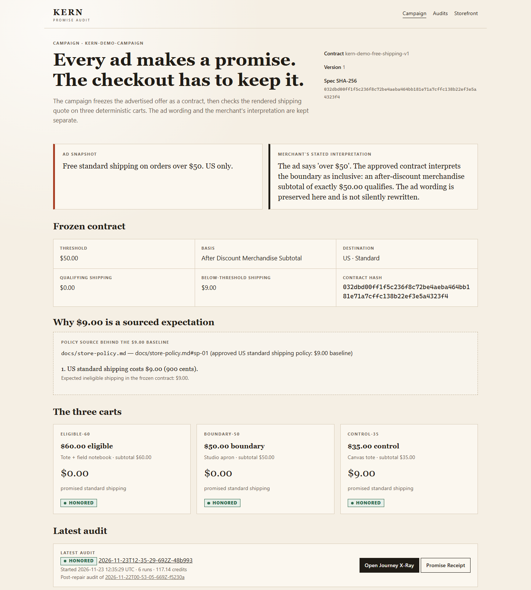
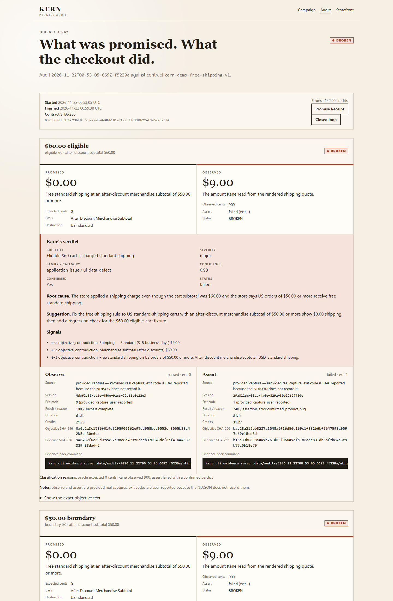
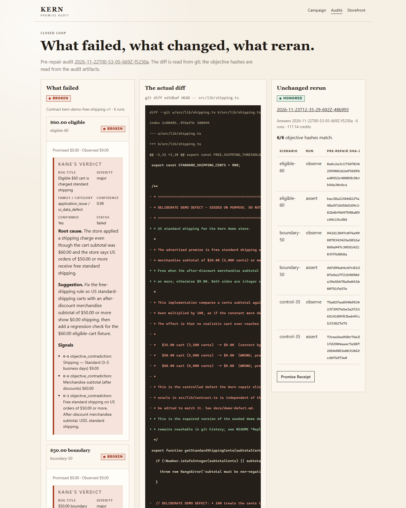

# Kern

Kern turns an advertised checkout promise into a frozen, merchant-approved contract, sends Kane CLI through the real storefront in a browser, and compares the rendered charge with a deterministic oracle. When the store is wrong, a bounded source repair is followed by the same challenge rerun unchanged. The demo has one storefront, one `free_shipping_threshold` promise, three carts, and two real audits.

## The proof

**Pre-repair audit** `2026-11-22T00-53-05-669Z-f5230a` — **BROKEN**

| Cart | Promised | Observed |
|---|---:|---:|
| $60.00 eligible | $0.00 | **$9.00** |
| $50.00 boundary | $0.00 | **$9.00** |
| $35.00 control | $9.00 | $9.00 |

Kane's assert runs returned `status: failed`, `result_code: 740`, `reason_code: assertion_error.confirmed_product_bug`, `verdict.confirmed: true` for the two broken carts. The control passed.

**The repair:** remove the `* 100` in `src/lib/shipping.ts` that compared a cents subtotal with a dollar-denominated threshold.

**Post-repair audit** `2026-11-23T12-35-29-692Z-48b993` — **HONORED**, `postRepair: true`, answers the pre-repair audit, and all six objective SHA-256 values are identical:

| Cart | Promised | Observed |
|---|---:|---:|
| $60.00 eligible | $0.00 | **$0.00** |
| $50.00 boundary | $0.00 | **$0.00** |
| $35.00 control | $9.00 | **$9.00** |

Every assert exited 0; every evidence pack is present.

The four numbers: **$60 → $9.00 (promised $0.00)** and **$35 → $9.00 (promised $9.00)** before the repair; **$60 → $0.00** and **$35 → $9.00** after it. The exact $50 boundary also moved from $9.00 to $0.00.

The $60 row in the full pre-repair audit is a provided real Kane capture; the live replacement `2026-11-23T12-27-07-978Z-a0c39f` repeats the $60.00/$9.00 observation with process exit codes. The $50 and $35 rows are live in the full audit. The post-repair audit is all live.

Full session/exits/reason/evidence ledger: [`docs/proof-ledger.md`](docs/proof-ledger.md).





*Real captures from the live local app on 2026-11-23. A public clone shows the recorded-audit banner instead.*

## The closed loop

The repair is the committed one-line diff. The post-repair audit answers the pre-repair audit and compares all six objective hashes; none moved.



## Judge it in five minutes

```bash
npm install && npm test && npm run dev
```

Open **http://127.0.0.1:3000**.

**The app works with no Kane account.** It ships sanitized copies of the two real audits in [`recorded/`](recorded/README.md). If `.data/audits` is absent — a public clone — the app reads `recorded/` and shows a visible banner on every recorded page: **“Recorded audit: replay of real runs, not a live session.”** No mock data is substituted. On the recording machine, `.data/audits` exists and the app prefers the live records.

What to click:

1. `/` — the ad snapshot and the merchant's interpretation as separate blocks, the frozen contract, the policy source behind $9.00, the three carts, and the latest audit.
2. **Audits** — every readable audit, newest first, with status, source, post-repair provenance, runs and credits.
3. **`2026-11-22T00-53-05-669Z-f5230a`** — Journey X-Ray: $60 Promised $0.00 / Observed $9.00, Kane's confirmed verdict; the $50 boundary and $35 control follow.
4. **Closed loop** — the actual `git diff ed3dbaf HEAD -- src/lib/shipping.ts`, then the post-repair audit and the 6/6 objective-hash comparison.
5. **`2026-11-23T12-35-29-692Z-48b993` → Promise Receipt** — the scoped status, contract hash, pre-repair audit id, per-scenario and per-run evidence, and the “what this does not prove” section.

The store is on `http://127.0.0.1:4173`. A 3:30 recording plan is in [`docs/demo-script.md`](docs/demo-script.md).

## Run it yourself with Kane

This is the second path, and it spends credits. A full three-scenario audit is six Kane runs and costs **roughly 140 credits**. The recorded runs reported 117–142 credits; exact per-run values are in each `audit.json`. The balance at recording time was **4,796.83**.

```bash
kane-cli login        # OAuth, or username/access-key
kane-cli whoami       # must say Authenticated
npm start             # store on 4173; leave it running
# in another terminal:
node scripts/kane-audit.ts
```

`0.10.6` was used; do not upgrade mid-evidence. The CLI writes `.data/audits/<auditId>/audit.json`, copies the real `.evidence` packs, and the app prefers those files. The app never starts Kane itself.

A cheap smoke run is `node scripts/kane-audit.ts --scenario control-35 --kind observe` (one run, roughly 20 credits).

## What is built

- One local storefront on 4173 with server-calculated shipping, three deterministic carts, and no payment fields.
- A frozen promise contract with SHA-256, a deterministic oracle, and boundary tests at 4,999 / 5,000 / 5,001 cents.
- A two-run Kane audit engine (observe + assert), strict NDJSON/USD parsing, fail-closed statuses, evidence copy and hash.
- A bounded repair and an unchanged post-repair audit gated by all six objective hashes.
- A read-only server-rendered app on 3000: campaign, audit list, Journey X-Ray, Promise Receipt, and the closed-loop diff.
- Public `recorded/` copies, a restore-safe pre-repair replay, and a pre-repair store runner for filming.

## What is not built

- Campaign wizard or contract-authoring UI.
- Automated coding-agent repair and approval UI; the fix is the committed branch change shown as a diff.
- Database, auth, multi-tenancy, or deployment.
- Live Kane execution from the app; the app is read-only.
- Screenshot viewer or fabricated evidence imagery.
- Signed or certified receipts.

## Limitations

- One owned demo store, one promise type (`free_shipping_threshold`), USD/US only, standard shipping.
- The evidence is **hash-linked, not signed or certified**. The receipt says “verified for the tested conditions at the recorded time” and explicitly lists what it does not prove.
- **Boundary-50 recording quirk:** the pre-repair boundary assert has an empty `final_state`; the observed `$9.00` is only in the run's `context.memory`. The parser reads that recorded value; the raw NDJSON remains the source of truth, and `tests/boundary-50.test.ts` pins it. Kane's boundary verdict describes the boundary rule, while the actual code defect was the `* 100` cents/dollars error. Treat the verdict as an observation, not a code diagnosis.
- Recorded copies keep the evidence SHA-256 values but not the `.evidence` files. A live `.data` audit keeps the files.
- A public clone uses `recorded/`; live `.data` evidence is local and gitignored.

## History

The buggy revision is reachable at `ed3dbaf`. Replay the defect without rewriting history:

```bash
git checkout ed3dbaf -- src/lib/shipping.ts
npm start
# the $60 cart is charged $9.00 again
git checkout HEAD -- src/lib/shipping.ts
```

`npm run demo:store-pre-repair` does the swap, prints **“PRE-REPAIR REVISION — seeded defect active”**, serves the store on 4173, and restores the fixed file when stopped. Narrate it as the revision that was audited, not a live audit.

The pre-repair characterization lives at `tests/replay/pre-repair.test.ts` and is excluded from `npm test`; `npm run demo:replay-pre-repair` restores `ed3dbaf`, runs only that file, restores the current file, and verifies the hash.

## Deeper docs

- [`docs/proof-ledger.md`](docs/proof-ledger.md) — real runs, sessions, exits, reasons, evidence hashes, spend.
- [`docs/decisions.md`](docs/decisions.md) — scope, boundary, claim rules.
- [`docs/demo-script.md`](docs/demo-script.md) — 3:30 shot list.
- [`docs/publish.md`](docs/publish.md) — publication commands, scan findings, post drafts.
- [`recorded/README.md`](recorded/README.md) — what was stripped, how to verify the originals.
- [`LICENSE`](LICENSE) — MIT.
