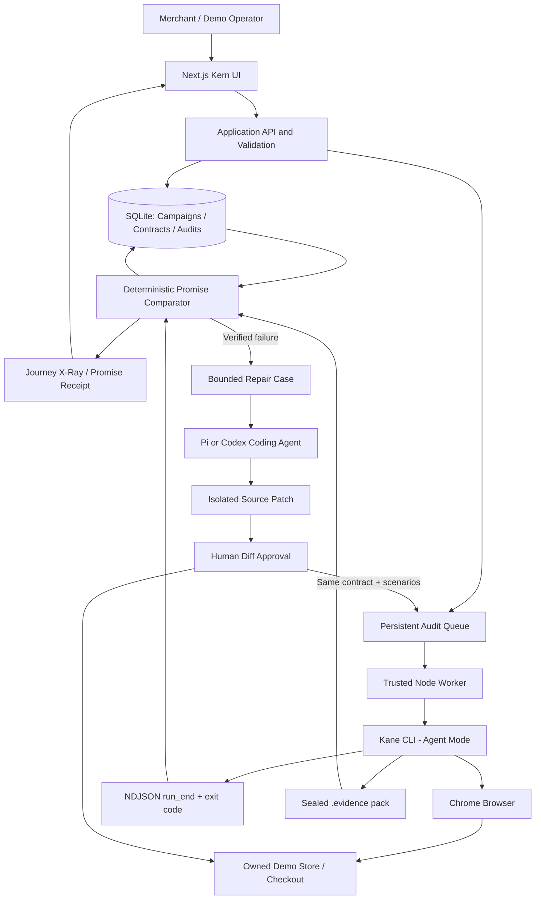
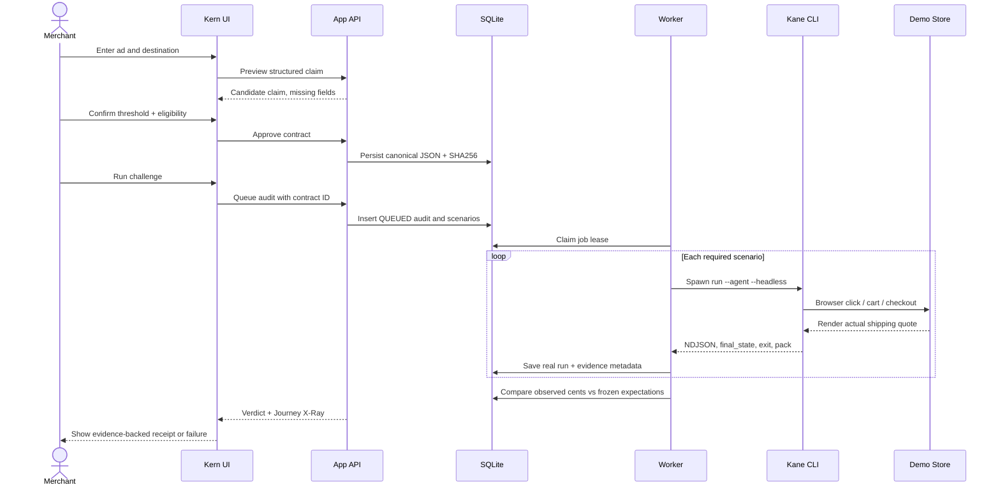
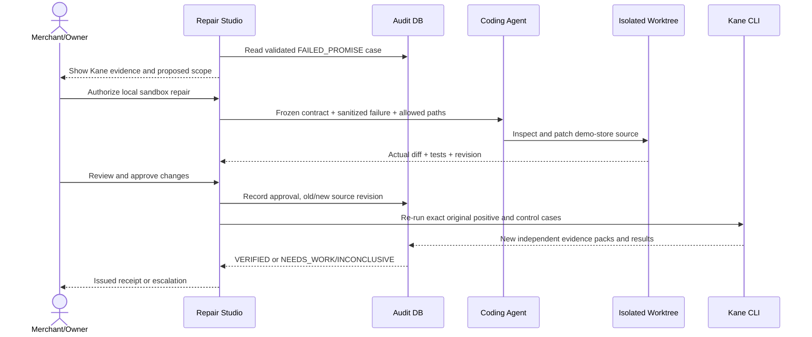

# KERN — SYSTEM ARCHITECTURE

> **Version:** 1.0 | **Date:** November 18, 2026 | **Architecture status:** Proposed, not provisioned or deployed.  
> **Guiding rule:** Kane CLI is the actual browser-execution and verification engine. Source repair is separate; product truth lives in frozen expectations plus independently observed state.

## 1. Architecture goals and decisions

**AD-01 Local-first execution for deadline.** Keep the working browser CLI on the developer's trusted computer or dedicated runner. Next.js can serve merchant UI but must not assume Vercel/serverless can execute long-running authenticated Chrome sessions.

**AD-02 Thin application, thick proof.** Prioritize one real end-to-end promise over broad integrations. Run histories and immutable receipts matter more than a large dashboard.

**AD-03 Separate roles.** The promise interpreter proposes; merchant approves; Kane observes; a deterministic oracle decides; a coding agent repairs within scope; Kane independently checks the new state. No component should self-certify its own fix.

**AD-04 Honest state machine.** Missing evidence is inconclusive, CLI setup failure is infrastructure error, a genuine observed mismatch is business failure, and aggregate verified status requires all required scenarios.

**AD-05 No unauthorized automated purchases.** P0 targets only a controlled local demonstration storefront with simulated orders and shipping quotes; no payment account necessary.

## 2. Context and component diagram



**Trust boundaries:** Browser pages and ad text are untrusted. The API and worker run trusted code. The coding agent gets only sanitized context and allowlisted source access. The receipt builder can only use validated stored evidence and a frozen contract.

## 3. Runtime and deployment topology

### P0 workstation topology

```text
Developer workstation (Windows or WSL/Linux, choose and document one)
  ├─ Node/Next.js server                     http://localhost:3000
  ├─ SQLite database                         .data/afterclick.db
  ├─ Separate Node worker                    polls jobs / launches Kane
  ├─ Kane CLI + authenticated TestMu account
  ├─ Installed Google Chrome                 headless Kane browser
  ├─ Coding agent CLI (one selected)
  ├─ .data/evidence/                         private run artifacts
  └─ Local demo store at /demo-store         real browser customer flow
```

Both the UI and demo storefront can be served from one local origin for simplicity, but domain boundaries must be explicit in code to stop a future merchant URL from reaching arbitrary internal services. Run the worker on the same OS/environment as the authenticated Kane CLI, not across incompatible Windows/WSL credential homes without testing.

### Optional hosted topology (post-P0)

A hosted Next.js API and database may enqueue jobs to a separate authenticated Linux/Windows worker. This requires job authentication, encrypted object storage, leases, restricted network egress, secret management, worker scaling and artifact access control. **Do not call this implemented unless deployed and tested.**

## 4. Data flow: campaign → audit → receipt



**Business truth source:** The approved contract defines *what should happen*. The actual store browser UI, exercised by Kane, defines *what happened*. The typed comparator joins the two. Do not copy the store's internal shipping calculation into the comparator or the testing becomes circular.

## 5. Data flow: failure → repair → independent retest



The coding agent cannot decide the validation result. A passed unit test does not replace Kane; Kane's own pass does not replace monetary and negative-control checks. Deployment to production remains a separate explicit merchant action not included in P0.

## 6. Component responsibilities

| Component | Must do | Must never do |
|---|---|---|
| Campaign API | Validate input, store ad snapshot and approved destination | Fetch arbitrary URLs or evaluate unknown claims as certain |
| Claim normalizer | Produce typed candidate with uncertainty | Automatically approve inferred thresholds |
| Contract service | Canonicalize and hash approved spec | Mutate approved spec after failure |
| Challenge generator | Emit deterministic P0 positive/control fixtures | Rewrite tests to fit observed incorrect output |
| Queue coordinator | Persist run, idempotency and worker lease | Launch multiple duplicate jobs for double clicks |
| Kane adapter | Spawn official CLI with safe argument array, capture terminal result and pack | Fabricate pass or infer business success from exit code alone |
| Comparator | Parse typed amounts and evaluate against frozen contract | Read predicted result from model copy or frontend badge |
| Receipt service | Generate immutable scoped artifacts from validated records | Issue unconditional merchant-wide certification |
| Repair adapter | Generate bounded code diff and agent transcript | Auto-deploy or modify secret/test files |
| Frontend | Explain actual state, evidence and approved actions | Display synthetic completion animations as real run activity |

## 7. Kane execution adapter in detail

### Invocation pattern

For each scenario, the worker builds a natural-language Kane objective from server-controlled template variables. It launches `kane-cli` using `child_process.spawn(executable, args, {shell:false, cwd:trustedRepoDir, ...})` with a wall-clock timeout. CLI/stdout should not get application secrets in its objective. User-provided ad text is quoted/sanitized as *data*, never treated as operational instructions.

**Canonical P0 objective template** (adapt selectors/steps after verifying the real UI):

```text
Go to http://localhost:3000/demo-store. Add the authorized demo item that
creates a $60 after-discount merchandise subtotal. Proceed to the shipping
quote step without placing an order. Store the displayed cart subtotal as
'observed_subtotal' and the displayed standard shipping charge as
'observed_shipping'. Verify the subtotal is $60 and shipping is $0.
```

Control run: `$35` subtotal, `$9` shipping. Kane's `store as` phrase is documented and important: extraction must enter `final_state`, not merely be reported in prose. CLI `run --agent` emits NDJSON with stable `run_end`; the implementation must capture the *actual* installed version's output and process exit. TestMD suite completion semantics differ.

### Handling a failed assertion that stops a run

For a first-pass challenge, split observation and assertion tasks where necessary. An assertion-driven run may fail before collecting all desired values. The robust implementation can first **observe and store** values via Kane, then run an explicit **assertion** objective, linking both run IDs to one scenario. Verdict must distinguish an observed mismatch from failure to navigate. In the deadline-constrained MVP, use whichever pattern actual Kane evidence validates; avoid claiming a failed step proved an amount if no value was captured.

### Terminal result conditions

```text
VERIFIED_FOR_TESTED_CONDITIONS only if:
  every required scenario has:
    Kane process exit 0 + terminal status passed
    required final_state values present + parsed
    numeric observations match frozen contract expectation
    actual URL belongs to approved origin
    evidence pack exists and validates
  and contract hash matches pre-run immutable snapshot
  and negative-control scenario also passes

FAILED_PROMISE if:
  evidence establishes actual business mismatch for required scenario
  (a Kane failure without observed behavior is not sufficient)

INCONCLUSIVE if:
  browser navigated but observation/interpretation/evidence incomplete

INFRA_ERROR if:
  Kane unavailable, auth failed, Chrome couldn't launch, worker crashed

CANCELLED if:
  user/timeout policy ended run; surface timeout separately in details
```

### Evidence storage

Store file path **privately** and hash of the real Kane `.evidence` file. Include run ID, timestamp, CLI version and Test Manager URL only if returned. The official evidence viewer can serve packs locally (`kane-cli evidence serve <path>`). The hosted viewer must not be misrepresented as a public durable URL to local files. Sanitize screenshots/console logs before sharing with judges.

## 8. Claim and scenario generation

P0 claim model is deliberately restrictive. Use a discriminated union with only `free_shipping_threshold`. Store fields `country`, `currency`, `shippingMethod`, `thresholdBasis`, `operator`, `cents`, `qualifyingProductIds` and explicitly defined exclusions. A shipping promise without threshold basis cannot be approved. Merchant can edit AI-suggested text before freezing it.

Example contract:

```json
{
  "type": "free_shipping_threshold",
  "currency": "USD",
  "thresholdCents": 5000,
  "thresholdBasis": "after_discount_merchandise_subtotal",
  "shippingMethod": "standard",
  "eligibleCountry": "US",
  "scenarioIds": ["eligible_cart_60", "negative_control_35"]
}
```

Hash and version the entire approved object plus a snapshot of the ad claim. A later terms change creates a version 2; reruns against version 1 remain historically accurate.

## 9. Database and write integrity

Use transactional inserts for an audit plus its required scenario rows. A worker claims a job with an atomic lease (`lease_owner`, `lease_expires_at`, `attempt`). Persist each child process exit and run event. On restart, a stale lease moves to `INCONCLUSIVE` or a safely retried queued state with explicit trace; never quietly mark success.

Receipt issue should be one transaction validating:

1. Immutable contract referenced by the audit.
2. All required scenario IDs accounted for.
3. Run status, parsed actual values and evidence hashes validated.
4. Negative control passed.
5. Current verdict equals derived verdict.
6. Receipt stored as append-only JSON with its own SHA-256.

Local SQLite file and `.evidence` packs remain gitignored. Sanitized manually selected proof artifacts may be placed under `docs/proof/` along with clear provenance and instructions for reproducing originals.

## 10. Domain model and data ownership

```text
Merchant 1─N Campaign 1─N PromiseContract 1─N Scenario
                                      │
                                      └─N Audit 1─N KaneRun
                                                   │
                                                   └─N Finding 1─N Repair
                                            Audit 1─N Receipt
```

All claim/run/repair objects are scoped to a merchant. The single demo merchant may be hardcoded for local-only hackathon but must not be treated as a secure multi-tenant auth solution for public production. Separation of operator-only repair endpoints is required even in demo mode.

## 11. Security model and risk controls

**Trusted URL boundary:** P0 permits only local demo origin from server config. Refuse user-submitted arbitrary loopback/private IP redirects and targets. In the future, verify domain ownership or explicit authorization and protect against DNS rebinding. No arbitrary URL fetch from frontend actions.

**Trusted source boundary:** Repair tool is restricted to isolated worktree and store shipping implementation. Block file edits to canonical tests, verification oracle, secret files, security rules and receipts. Require human approval to apply patch; retain diff and source commit SHA.

**Prompt-injection boundary:** Ad copy, webpages, Kane step remarks and logs are untrusted. They may inform failure diagnosis but cannot override instructions, access policy or allowed commands.

**Payment boundary:** The demo store stops at shipping quote; no real credit-card data, purchase, external checkout or fulfillment. On third-party sites, active execution should be disabled unless the merchant authorizes tests and the runner has safe stop conditions.

**Data boundary:** Evidence may capture personal information, browser profiles, cookies or hidden tokens. Use a clean automation profile, fixture data, redaction and private storage; document retention/deletion. Never add credentials to GitHub or public YouTube footage.

## 12. Reliability and failure analysis

| Failure | Product response | Proof requirement |
|---|---|---|
| Kane not authenticated | INFRA_ERROR + actionable setup guidance | Exit code/stderr summary |
| Chrome cannot launch | INFRA_ERROR | Logs; never merchant blame |
| Destination redirects outside allowlist | Stop, INCONCLUSIVE/ERROR | Blocked URL and reason |
| Kane cannot locate checkout UI | INCONCLUSIVE | Step and screenshot if present |
| Price value has ambiguous currency | INCONCLUSIVE | Raw untrusted string, sanitized |
| Actual $9, expected $0 | FAILED_PROMISE | Real observed amount and pack |
| Agent fixes $60 but breaks $35 | NEEDS_WORK | Original negative-control run |
| Agent fails twice | ESCALATED | Attempts log and no hidden retry |
| Worker crashes after run | Recovery based on DB state | No orphan marked passed |
| Test pack missing/corrupt | No verified receipt | Validation failure |

## 13. Scale plan after P0

1. Replace local queue with a durable leased job queue; add multi-worker concurrency and rate limits.
2. Use remote authorized browser runners with secrets isolated from app API.
3. Move SQLite to Postgres, evidence to private encrypted object storage, signed ephemeral artifact URLs.
4. Add verified merchant domains, team roles, store/platform connectors, connector-specific permissions.
5. Add campaign versions and scheduled daily/after-deploy reruns; drift trends and notification channels.
6. Extend promise types as separate typed evaluators, not one universal "AI says true" prompt.
7. Add transparent metering and billing only after validated customer demand and costs.

These are architecture directions, not hidden P0 obligations.

## 14. Architectural acceptance checks

- Start Next.js and worker separately; worker can invoke actual Kane CLI and return job completion to UI.
- With seeded bug, independent Kane observation detects $9 unexpected shipping for eligible cart and records a failure.
- Negative control pass shows the system discriminates eligibility, not just flags all quotes.
- After an authorized code patch, both original scenarios pass under new run IDs with validated evidence.
- Evidence/receipt compare is deterministic and refuses mismatched contract hashes.
- Simulated CLI failure or missing pack yields an error/inconclusive receipt, never a verified badge.
- No external site or real money is involved in P0.

## 15. Primary references

- Kane source/CLI output: https://github.com/LambdaTest/kane-cli
- Kane user guide: https://github.com/LambdaTest/kane-cli/blob/main/docs/user-guide/README.md
- Kane evidence: https://github.com/LambdaTest/kane-cli/blob/main/docs/user-guide/evidence.md
- Kane testmd run/replay: https://github.com/LambdaTest/kane-cli/blob/main/docs/user-guide/testmd/running.md
- Official hackathon: https://www.kaneclihack.sh/
- Previous winners: https://www.testmuai.com/blog/kane-cli-hackathon-winners/
