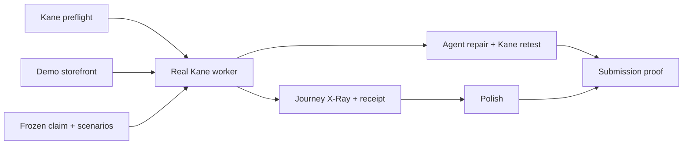

# KERN — FULL MVP BUILD PLAN

> **Status:** Execution playbook, NOT completed work.  
> **Planning date:** November 18, 2026 | **Competition deadline:** November 19, 2026, 7:29 PM WAT (11:59 PM IST).  
> **Scope rule:** Finish an actual Kane-driven promise audit and independent fail→repair→pass proof before adding any optional feature.

## 0. What "MVP complete" actually means

A merchant can enter an actual advertised promise, freeze its test conditions, launch Kane CLI as a mystery shopper through a functioning store, inspect a real observed mismatch with evidence, approve a bounded coding-agent fix, see Kane independently rerun the unchanged challenge, and receive an evidence-backed Promise Receipt that clearly limits what was verified.

The P0 claim is **one promotion, one authorized demo storefront, one shipping promise, two shopper scenarios, and one real repair**. No third-party checkout payments, paid monitoring or live Shopify/Meta integration.

## 1. Mandatory decisions / guardrails

- **Stack:** Next.js/React/TypeScript, local SQLite, separate trusted Node worker, Kane CLI + Chrome, one coding agent (Codex or Pi), simple local artifacts.
- **Project setup:** initialize new event-compliant public repo, commit all actual source and docs. Use `docs/` for these Markdown specifications.
- **One truth model:** source-approved claim = immutable contract; Kane-extracted browser values = observation; deterministic evaluator = verdict; receipt = immutable summary of the join.
- **One trust boundary:** user/ad/web content cannot run shell commands, choose arbitrary hosts, amend assertions or grant source edit permission.
- **One demonstration:** "$50 free standard shipping (after-discount eligible merchandise subtotal), $60 eligible cart, $35 negative control, $9 ordinary shipping". Document USD/US locale fixture explicitly.
- **One repair target:** genuine shipping rule in demo source, not labels/mock data. Failing source may deliberately use an incorrect threshold; code diff corrects it.
- **No false green:** all real Kane runs, observable extracted values, valid evidence, contract hash integrity, both challenge cases required.

## 2. Slice-by-slice delivery

Each slice is vertical, bounded, demonstrable and commit-worthy. Agent should not build more screens/routes than the slice needs. Each gate has explicit proof. Do not turn every line of this plan into a separate agent session if time is limited.

### Slice S0 — Environment and Kane proof-of-life

**Build:** Configure Node/Next.js workspace; install and authenticate Kane; confirm Chrome and CLI installed in *the same environment where worker will run*. Use a safe publicly reachable baseline page to verify Kane one-shot agent mode. Check tool version, logged-in status and credits; store no secrets in repository.

**Commands:**

```bash
npm install -g @testmuai/kane-cli
kane-cli --version
kane-cli login --oauth
kane-cli whoami
kane-cli balance
kane-cli run "Go to https://example.com and verify the title contains 'Example'" --agent --headless --timeout 180
```

**Proof gate:** Real CLI terminal `run_end`, exit status, no auth/setup error; record installed version and sanitized output in private notes. If failed, fix environment before writing a mock runner.

**Deliverable:** committed package scaffold, `.env.example`, `scripts/preflight`, verified Kane environment notes.

### Slice S1 — A genuine commerce journey

**Build:** A tiny usable `/demo-store` with product cards, cart controls, merchandising subtotal and `/demo-store/checkout` shipping quote. Use deterministic catalog fixture items producing after-discount subtotal $60 and $35 (separate scenario links may preset carts). Show subtotal, shipping, total in text (with reliable semantic labels). No real order submit button.

**Seed intentional bug:** `getShippingQuote()` in demo store's real server logic incorrectly charges $9 for $60; $35 appropriately pays $9. The bug cannot be an arbitrary UI badge. Checkout must derive shipping from actual server logic/quote and display it.

**Unit tests:** independent expectation function says >=5000 cents gets $0; $35 gets $9. The deliberately defective store is expected to fail an acceptance test pre-repair. Mark seed as controlled challenge only; do not leave a production vulnerability.

**Proof gate:** a human in Chrome can navigate, add products, see $60/$9, and repeat $35/$9. Working cart state persists across navigation in the demo session.

**Deliverable:** real storefront + fixture setup/reset script + seeded bug with clear provenance.

### Slice S2 — Campaign Wizard and frozen Promise Contract

**Build:** `/app` plus new campaign form, ad text input, optional screenshot supporting upload, authorized destination prefilled to demo store. Typed `free_shipping_threshold` fields and review UI. Allow merchant to approve **exact** meaning: after-discount eligible subtotal >= $50, standard shipping, US/USD, qualifying products, no tax affecting threshold. Persist canonical JSON, version, hash, timestamp and approver.

**AI support:** if model API exists, prefill candidate claim, but never hide missing terms or auto-approve. Without API, the typed manual path must be complete. Screenshot extraction is optional at this deadline; screenshot attachment itself can be implemented as supporting evidence without claiming OCR was run.

**Proof gate:** saved campaign renders its frozen claim and two scenarios. Editing an approved claim creates a new version, not a mutation. Approve button refuses ambiguous terms.

**Deliverable:** campaign form, contract service, scenario preview and DB migrations/fixtures.

### Slice S3 — Real Kane worker integration

**Build:** Node worker isolated from Next.js request path. Audit API persists `QUEUED`; worker leases it and calls `kane-cli run --agent --headless --timeout 180` on the allowed local store origin, once for each required scenario. Use argument arrays and `shell:false`; separate stdout/stderr; parse real `run_end`, final state and exit code. Capture real `.evidence` and optional Test Manager URL. Stream/poll status via API.

**Important:** Script observations with the documented **`store as`** extraction, not vague "read the shipping price" wording. `run_end.status` and exit code are necessary but not sufficient. The independent oracle parses observed USD to cents and checks business outcome.

**Output model:** `QUEUED`, `RUNNING`, `FAILED_PROMISE`, `VERIFIED_FOR_TESTED_CONDITIONS`, `INCONCLUSIVE`, `INFRA_ERROR`, `CANCELLED`. A browser step error with unknown shipping is not proof of a broken promotion. All statuses must be derived, not manually typed.

**Proof gate:** clicking **Run Mystery Shop** causes genuine Kane browser action and two recorded results. With seeded bug, the positive scenario has objectively observed $9 vs expected $0, while control is $9 vs $9. Evidence available. The UI shows a clear failure, not a fake number.

**Deliverable:** audit worker + parser + database records + integrated results route.

### Slice S4 — Journey X-Ray and Promise Receipt v1

**Build:** A presentation-quality `/app/audits/[id]` that visualizes the journey as stages (ad / landing / product / cart / shipping quote) using *actual step metadata and real observations*. Highlight the first proven mismatch; show expected and observed amounts, shopper conditions, CLI outcome and evidence link. A minimal receipt is generated as structured JSON and human-readable page with contract hash, timestamps, per-scenario outcomes, Kane evidence pack hash and caveats.

**Do not:** fabricate a video player or screenshot carousel if Kane didn't produce those artifacts. Do not refer to simulated figures as real commerce purchases. The only supported outcome in P0 is a checkout preview/shipping quote, not paid fulfillment.

**Proof gate:** reviewer sees contract + evidence + amount mismatch + why the control passed, without looking at raw JSON. Missing pack blocks verified status.

**Deliverable:** Journey X-Ray, evidence viewer/link handling, receipt builder with tests.

### Slice S5 — Coding-agent repair and GuardianKane-inspired gate

**Build:** A repair case from a genuine failed audit. Include frozen contract hash, actual Kane failure fields, source revision, intended files, fix boundary and explicit negative-control requirement. Use **one** selected coding agent, preferably the one already installed/authenticated in the build environment. If automated from app, invoke in a guarded worktree; if terminal-driven, log real commands and show this honestly in the UI/report.

**Example restricted agent brief:**

```text
You are repairing one real Kern demo-store bug.
Source of truth: the frozen approved Promise Contract and scenario IDs.
The Kane audit observed a $9 standard shipping charge for an eligible $60
cart, though the contract promises $0 for eligible after-discount merchandise
subtotals >= $50. A $35 ineligible control must continue to pay $9.
Inspect only the authorized shipping quote implementation and directly related
unit tests. Do not edit the Promise Contract, challenge expectations, receipt
logic, Kane runner/parser, app-wide configuration or secrets. Correct the root
cause, explain the diff, run relevant unit/type checks. Do not claim complete
until Kane independently passes both original browser scenarios. Preserve all
unrelated working-tree changes.
```

**Human gate:** show diff + changed paths. Reject forbidden modifications, unexpected dependency installs or fake-test substitutions. Apply approved patch on controlled branch. Record old/new commit hashes, agent invocation and actual tests.

**Kane gate:** rerun original eligible $60 and control $35 scenarios, check new real extracted shipping values `$0` and `$9` against unchanged contract hash, and validate their evidence. Never edit tests to fit the fix. Maximum two agent repair attempts; otherwise escalate.

**Proof gate:** real before/after source diff plus two new Kane successes with valid evidence and exact same contract/scenario IDs. This is the award-defining milestone.

**Deliverable:** repair case, selected agent adapter or documented terminal session, approval flow, independent re-verification and linked proof.

### Slice S6 — Merchant experience and polish

**Build:** Landing page with sharp pitch and clear CTA; campaign dashboard with live audit history; consistent visual components and accessible state design; Journey X-Ray becomes the visual focal point. Responsive design for phone viewers but prioritize real Chrome desktop demo. Use subtle status changes and clean spacing, not visual noise.

**Brand direction:** Kern is bold, modern, investigative and commerce-oriented; no overreliance on generic cyberpunk AI dashboards. Visual metaphor: two parallel lanes — "What was promised" and "What happened" — converging into a receipt. Color semantics: neutral for unknown, red for verified mismatch, amber for inconclusive, green only for verified scenario. All statuses have text labels.

**Proof gate:** user unfamiliar with Kane can create, audit, inspect and understand result in under a short guided walkthrough; visually legible on 1080p recording. Important controls keyboard accessible.

**Deliverable:** coherent product UX and polished demo screens using real state.

### Slice S7 — Submission, reproducibility and demo

**Build/docs:** Public GitHub repo, README, exact `npm install`, config/seed, run commands, `.env.example`, Kane setup and expected results. Include a high-level architecture diagram, known limitations, safety scope and reason Kane is required. Store no secrets, private Chrome profile or unredacted packs in source control. Source files and generated reproducible test definitions belong in repo; large/local private evidence packs do not.

**Video:** film actual Kane runs and app interaction, trim to three-minute maximum judging window, with clear narration/captions and visible before/after evidence. Upload to YouTube, verify link accessible.

**Posts:** two distinct public posts about the project on allowed platforms if as required by event site; preferably a build story with real failure evidence and a final demo/repo link. Keep claims precise.

**Proof gate:** a reviewer can open repo/video/post links and reproduce the shipped path; form submitted before deadline.

**Deliverable:** final release commit, proof ledger, working demo video, public project announcements and form confirmation.

## 3. Dependency graph / parallelization



**Parallel safely:** one track can build store while another designs visual components; however, do not let independent agents modify the same files or both redefine contracts. The Kane worker must know real DOM/labels from the finished store. Source of truth is PRD IDs + frozen fixtures.

## 4. Build/QA commands and expected evidence

Example local scripts to implement (names are proposed application scripts, not official Kane CLI commands):

```bash
npm run dev                     # Next.js + demo store
npm run worker                  # separate job worker
npm run db:migrate              # ensure tables exist
npm run db:seed                 # seed demo campaign and products
npm run db:reset-demo           # reset fixture for reproducible before state
npm run typecheck
npm run lint
npm test
npm run demo:preflight         # verify Kane/Chrome/local endpoints
npm run demo:audit             # invoke actual worker audit
npm run demo:verify-repair     # rerun original challenge
```

The agent must implement the scripts before presenting them as working commands. Actual Kane usage independently:

```bash
kane-cli --version
kane-cli whoami
kane-cli run "Go to http://localhost:3000/demo-store and verify the page heading contains the demo store title" --agent --headless --timeout 180
# Replay a saved test only after it actually exists:
kane-cli testmd run ./tests/kane/eligible_shipping_test.md --agent --headless
# Validate a real pack path, not a placeholder filename:
kane-cli evidence validate <actual-evidence-pack-path>
```

Note `testmd run` output is not guaranteed identical to one-shot `run` output; the parser for saved tests must await file-level completion (`test_md_done`) and process exit. Verify actual installed CLI syntax/help as versions change.

## 5. Acceptance test inventory (P0)

| ID | Scenario | Expected | Evidence |
|---|---|---|---|
| AT-01 | New campaign with valid offer terms | Draft persists | App/DB |
| AT-02 | Missing threshold basis | Approval blocked | Unit/UI |
| AT-03 | Approve and attempt mutation | Frozen hash unchanged | DB/unit |
| AT-04 | Seeded $60 eligible cart before fix | Real Kane finds shipping $9 and marks failed promise | Kane pack + parsed amount |
| AT-05 | Seeded $35 control before fix | Real Kane observes $9, valid control | Kane pack |
| AT-06 | Kane absent/unauthed | `INFRA_ERROR`, not merchant failure | Integration test |
| AT-07 | Unparseable amount or missing evidence | No verified receipt | Parser test |
| AT-08 | Repair tries to alter tests or `.env` | Reject unauthorized patch | Security test |
| AT-09 | After approved source fix, $60 cart | Kane observes $0 with fresh run | Kane pack |
| AT-10 | After approved source fix, $35 control | Kane observes $9, no overbroad free shipping | Kane pack |
| AT-11 | Contract version changed before retest | Cannot reuse original receipt; new version required | Domain test |
| AT-12 | Issue receipt after genuine successful challenge | Hash/IDs/observations/caveats populated | UI + DB + pack |
| AT-13 | Duplicate Run button | One queued audit per idempotency key | API test |
| AT-14 | Refresh during background job | Correct durable status remains | App test |
| AT-15 | Receipt redaction | No auth tokens, user data, private filesystem leaks in public export | Privacy test |

## 6. Hard scope prioritization when time gets tight

**Never cut:** actual Kane run, correct statuses, frozen claim, one real failure, true agent patch evidence, same-case re-verification, negative control, public README/demo.

**Cut first:** login/auth for multiple merchants, polished onboarding animations, AI visual ad extraction, arbitrary claims, browser recording player, public receipt sharing, mobile device grids, subscriptions, Meta/Shopify APIs, continuous monitoring, email notifications, analytics charts, cloud worker deployment.

**If stuck on in-app repair adapter:** show the honest terminal agent invocation and source diff recorded in a repair case, then make Kane rerun in app. Explicitly label manual orchestration. This is better than claiming a nonexistent autonomous repair service.

**If stuck on multi-scenario Kane:** preserve one real positive run and one actual control if possible; without control, explicitly mark limited coverage and do not boast adversarial verification. Do not substitute component tests and claim they are Kane browser evidence.

## 7. Demo storyboard (≤ 3:00)

| Time | On screen | What the narration proves |
|---|---|---|
| 0:00–0:20 | Ad claim vs real checkout expectation | Real customer problem; understandable financial stakes |
| 0:20–0:45 | Promise Studio, frozen threshold and two challenges | Claim becomes precise, owner-approved test |
| 0:45–1:20 | Real Kane browser run / Journey X-Ray shows $9 vs $0 | Sponsor tool actually operates product; failed promise proven |
| 1:20–1:50 | Coding-agent repair case + real code diff | Actual fix in owned source, not a fake UI badge |
| 1:50–2:30 | Kane reruns $60 and $35 flows; both pass | Independent verification and negative control |
| 2:30–3:00 | Promise Receipt, raw evidence ref, scope caveat, repo and takeaway | Reproducible proof, customer value, reason to return |

**Narrative refrain:** "The agent can write the fix. Kane has to prove the customer gets the promise." Use real screen captures; do not compose fictitious terminal output.

## 8. README structure for judges

```text
# Kern
One-sentence promise + architecture overview
## What the product does (Maya's use case)
## What Kane CLI uniquely powers
## Prerequisites (Node, Chrome, Kane auth, coding agent)
## Start app / worker / seed local fixture
## Reproduce known failing promise
## Reproduce coding-agent patch and unchanged passing rerun
## Inspect real Kane evidence + Promise Receipt
## Tests and quality commands
## Actual feature status (shipped vs planned)
## Demo video, screenshots, links
## Known limitations, privacy/safety and no-real-payments note
```

Explicitly state which services are mocked/local, which external APIs are not connected and whether repair automation is manual or integrated. Don't hide setup costs or unavailable hosted accounts.

## 9. Evidence packet and proof ledger template

**Do not fill this with fake transaction IDs.** Only append after actual run.

```markdown
### Run <real-run-id> — <real timestamp>
- Purpose: failing baseline / negative control / repair retest
- Contract ID + SHA256: <actual>
- Store revision: <actual Git SHA>
- Kane version: <actual>
- Command: <actual sanitized invocation>
- Exit code and stable terminal event: <actual>
- Expected cents: <actual frozen contract>
- Observed cents: <actual Kane extraction>
- Evidence file path, SHA256, validation: <actual>
- Test Manager link (if returned): <actual>
- Merchant verdict and reason: <derived>
- Caveats: no real payment; US/USD test fixtures; time-limited
```

For repair: include agent name/version, patch file/diff hash, human approval record, before/after Git commits, and retest run IDs. Add genuine negative findings or setup issues to a `Known limitations` section.

## 10. Post-submission roadmap (separate from MVP)

**Phase P1 — Automated monitoring:** saved browser challenges, scheduled Kane reruns, new mismatch alerts, change/drift comparisons, retention policy.

**Phase P2 — Platform connectors:** merchant-authorized Shopify/BigCommerce data reads, Meta/Google ad imports via official APIs, campaign link correlation, domain verification.

**Phase P3 — Multi-channel promise coverage:** percent discounts and gifts, checkout fee surprises, shipping/availability expectations, device/location coverage with clear evidence boundaries.

**Phase P4 — Agency product:** teams, multi-store reporting, shareable signed receipt registry (only if actually implemented), SaaS metering and billing based on validated buyer demand.

In all phases, **Kane remains the browser operator and independent verifier**; do not let the app drift into an unrelated marketing analytics product.

## 11. Definition of done (binary launch checklist)

- [ ] App, worker, DB and owned demo store run locally from published source.
- [ ] One frozen promo contract and two deterministic shopper scenarios exist.
- [ ] Real Kane operates Chrome against store; `run_end`/exit and extracted amounts captured.
- [ ] Authentic failed promise shown with real screenshot/evidence.
- [ ] Actual coding agent edits allowlisted store source; human review and diff recorded.
- [ ] New Kane executions independently pass unchanged eligible and negative-control scenarios.
- [ ] Receipt derives its verdict from evidence and preserves scope, hashes, IDs and time.
- [ ] Missing/auth/error runs cannot be mislabeled verified.
- [ ] README reproduces the shipped loop; no hard-coded demo results masquerade as tests.
- [ ] Public GitHub, YouTube video, required public posts and form finished before deadline.

## 12. Immediate agent handoff

Give the agent **all six documents**, but use the short instructions below to prevent it from attempting a giant speculative rewrite:

```text
Implement Kern for the Kane CLI Hackathon following docs/project idea.md,
docs/prd.md, docs/trd.md, docs/architecture.md, docs/project plan.md,
and docs/full mvp_plan.md.

Priority is a REAL Kane-powered fail -> authorized coding-agent source repair ->
Kane pass loop with an eligible $60 and control $35 cart. Start by confirming
installed Kane version/auth, Chrome availability, and a real `run --agent`
baseline. Do not emulate Kane outputs. Build one bounded vertical slice at a
time, keeping working app paths functional after each slice. Use exact typed
claim semantics and immutable contract hashes. The observed price must come
from the real browser, not an expected value or mock. Never allow an agent to
edit approved expectations to make a failed test green. Run tests and report
changed files, exact verification, genuine evidence, status and next blocker.

Do not add Shopify, Meta Ads, payments, monitoring or multi-tenant SaaS before
the complete demo loop is reproduced. Preserve unrelated changes; avoid
speculative architectural refactors and repeated unnecessary test loops.
```

## 13. References

- Official event: https://www.kaneclihack.sh/
- Kane CLI source + docs: https://github.com/LambdaTest/kane-cli
- Kane CLI `testmd` execution: https://github.com/LambdaTest/kane-cli/blob/main/docs/user-guide/testmd/running.md
- Organizer winner lessons: https://www.testmuai.com/blog/kane-cli-hackathon-winners/
- [PRD](prd.md) · [TRD](trd.md) · [Architecture](architecture.md) · [Project idea](project%20idea.md) · [Project plan](project%20plan.md)
